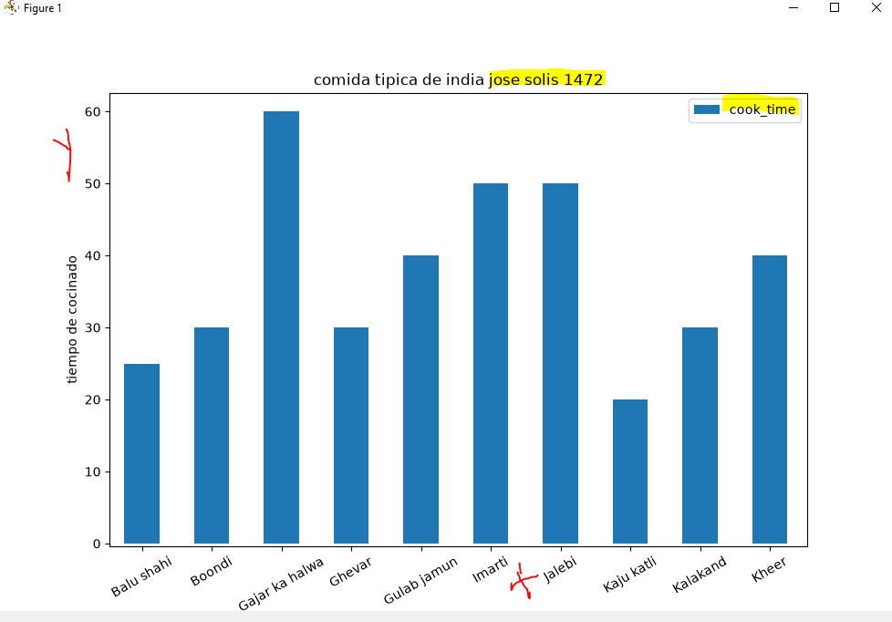
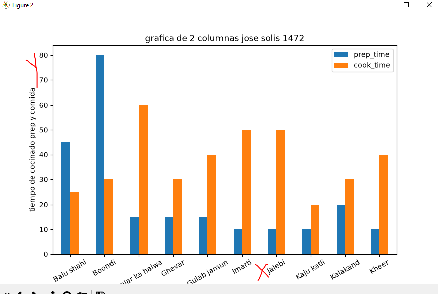
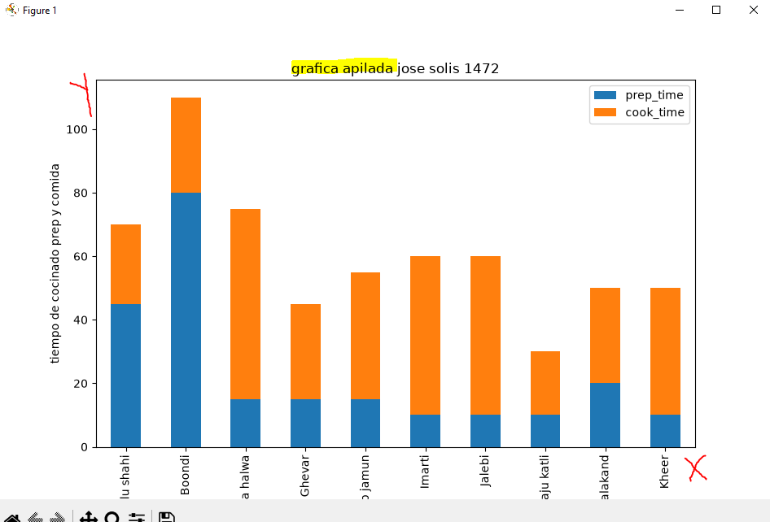

## Analisis exploratorio de datos
## comida del pais India
## jose solis nc 1472
## -+-+-+-+ Importando datos del archivo csv comida de india -+-+-+-+-

## -+-+-+-+ mostrar nombre comida + ingredientes -+-+-+-+-

### tiempo de cocción mostrar 10 registros con head

## creacion de grafica de barras 1472

## grafica de varias columnas

## grafica apilada

